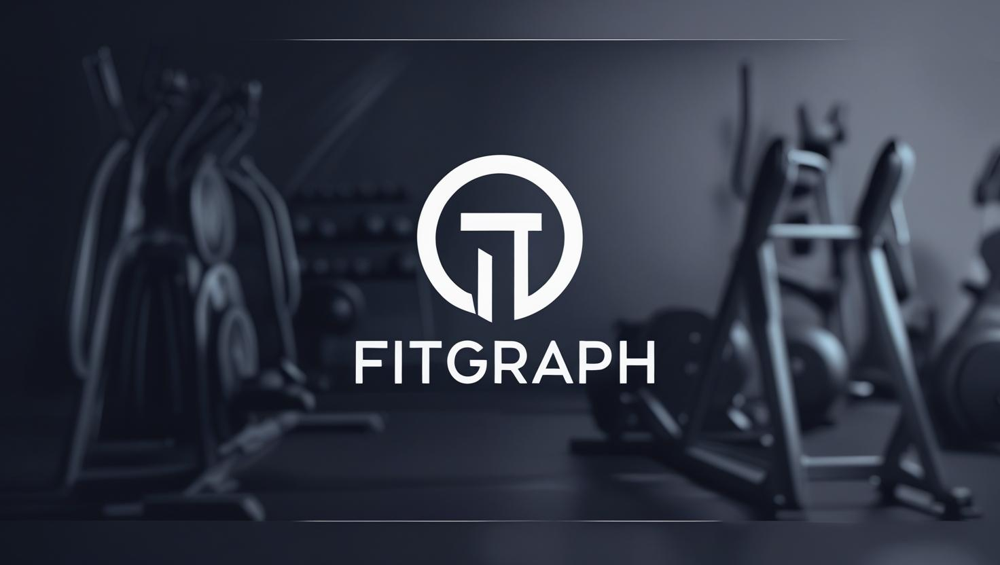

# 🏋️‍♀️ FitGraph — Modern Fitness & Weight Tracker

A modern, responsive, cyber-glassmorphic fitness and weight tracking web application recreated from the original FitGraph project. FitGraph is designed to look stunning on both mobile and desktop screens while providing seamless client-side tracking, interactive charts, and zero-dependency deployment.



---

## ✨ Features & Enhancements

- 🌌 **Cyber-Glassmorphism UI**: Built with modern CSS custom properties, backdrop blurs (`backdrop-filter: blur(20px)`), neon cyan/blue/emerald glows, and Google Fonts (*Outfit* and *Space Grotesk*).
- 🎬 **Animated Splash Screen**: High-impact brand intro featuring the FitGraph logo with smooth zoom-in entrance and instant "Skip Intro" option.
- 💬 **Motivational Quotes Banner**: Inspirational fitness quotes with live rotation (including Arnold's *"The pain you feel today will be the strength you feel tomorrow"*).
- 📊 **Interactive Analytics (Chart.js)**:
  - **Weight Progression Trend**: Track your weight change over time against your target goal line with 7D, 30D, and All-Time filters.
  - **Daily Calories Burned**: Dynamic bar chart showing workout energy expenditure.
  - **Workout Distribution**: Doughnut chart breaking down time spent across exercise disciplines.
- 🏋️‍♂️ **Workout & Weight Logger**:
  - Dynamically updates exercise categories based on your selected goal (*Weight Gain* vs *Weight Loss*).
  - Built-in **MET Calorie Estimator** that automatically computes estimated calorie burn based on activity and body weight.
  - One-click duration chips (`+15m`, `+30m`, `+45m`, `+60m`, `+90m`).
- 📋 **History & Data Manager**:
  - Searchable workout history table.
  - **Export to CSV**: Download `workouts.csv` and `weights.csv` anytime.
  - **Import CSV**: Upload existing workout or weight CSV files with auto-detection.
  - **Reload Demo Data**: Instantly populate the app with the historical workout records from July 2025.
- 🧮 **Bonus Fitness Tools**:
  - **Smart BMI Calculator**: Visual color-coded gauge with BMI category breakdown.
  - **Hydration Tracker**: Interactive 8-glass water tracker (2,000 ml daily goal).
- 📱 **Full Mobile Responsiveness**:
  - Desktop: Floating glass sidebar with profile switcher and navigation.
  - Mobile: Bottom navigation bar with touch-friendly tap targets and collapsible views.
- 🔊 **Web Audio Feedback**: Built-in pleasant chime synthesizer on logging workouts or completing hydration goals.

---

## 🚀 How to Run Locally

Since FitGraph is built as a pure modern static web application, it runs in any browser with zero installation required.

### Option 1: Python HTTP Server (Built-in)
```bash
python -m http.server 8080
```
Then open [http://localhost:8080](http://localhost:8080) in your browser.

### Option 2: VS Code / IDE Live Server
Right-click `index.html` and select **"Open with Live Server"**.

---

## 🌐 How to Deploy and Publish

### Method 1: GitHub Pages (Automated & Recommended)
This repository already includes `.github/workflows/deploy.yml` configured for automatic GitHub Pages deployment.

1. **Commit and Push your changes**:
   ```bash
   git add .
   git commit -m "Recreate FitGraph as modern responsive web application"
   git push origin main
   ```
2. **Enable GitHub Pages on your repository**:
   - Go to your repository on GitHub: `https://github.com/akhil-anandan/fitness`
   - Navigate to **Settings** > **Pages**
   - Under **Build and deployment** > **Source**, choose **GitHub Actions** (or `Deploy from a branch` -> `main` / root).
   - Your site will be published at:
     **`https://akhil-anandan.github.io/fitness/`**

---

### Method 2: Vercel (1-Click Deployment)
1. Visit [vercel.com](https://vercel.com) and log in with GitHub.
2. Click **"Add New Project"** and select `fitness`.
3. Keep default settings (Framework Preset: *Other*) and click **Deploy**.
4. You will get a free production URL like `https://fitness-tracker-xyz.vercel.app` with instant global CDN caching and SSL.

---

### Method 3: Netlify
1. Go to [netlify.com](https://netlify.com) and click **"Add new site"** > **"Import an existing project"**.
2. Select your GitHub repository `akhil-anandan/fitness`.
3. Set Publish directory to `.` (root) and click **Deploy FitGraph**.

---

## 📁 Project Structure

```
├── .github/
│   └── workflows/
│       └── deploy.yml        # Automated GitHub Pages CI/CD workflow
├── css/
│   └── style.css             # Cyber-glassmorphism responsive styles
├── js/
│   └── app.js                # Core app logic, Chart.js, LocalStorage, sound & tools
├── index.html                # Main semantic HTML5 single-page application
├── bg.jpg                    # High-res gym aesthetic background image
├── logo.jpg                  # FitGraph brand logo
├── fitness_tracker.py        # Original Streamlit implementation
└── README.md                 # Project documentation & deployment guide
```
